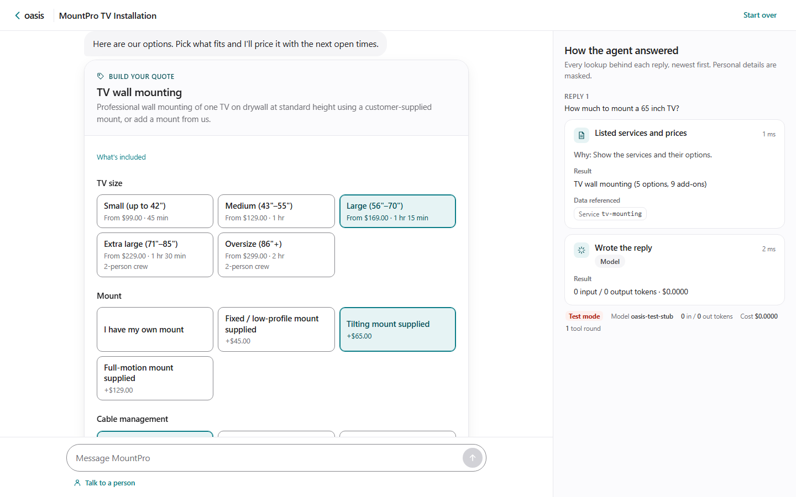
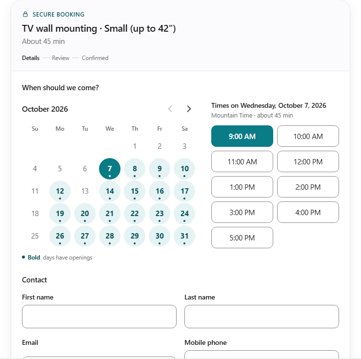
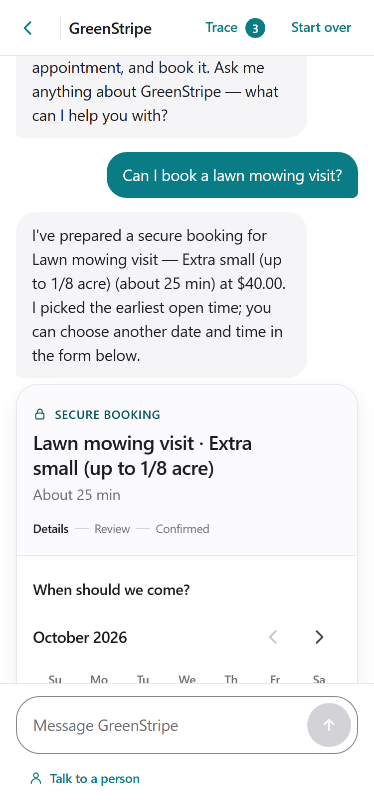
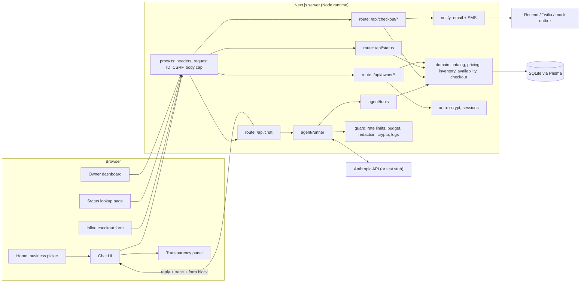

# Oasis

An AI sales, support and scheduling assistant that sells products, books appointments and shows its work.

[](https://github.com/U1186204/AI-Agent-Sales-Calls/actions/workflows/ci.yml)
[](https://github.com/U1186204/AI-Agent-Sales-Calls/actions/workflows/ci.yml)


**Contents:**
[What it does](#what-it-does) ·
[Quick start](#quick-start) ·
[Environment variables](#environment-variables) ·
[Owner dashboard](#owner-dashboard-access) ·
[Architecture](#architecture) ·
[Agent design](#agent-design) ·
[Data model](#data-model) ·
[Pricing and tax](#pricing-and-tax) ·
[Cost and budget](#cost-and-budget) ·
[Security and privacy](#security-and-privacy) ·
[Testing](#testing) ·
[Deployment](#deployment) ·
[Project structure](#project-structure) ·
[Troubleshooting](#troubleshooting) ·
[Roadmap](#roadmap) ·
[License and contributing](#license-and-contributing)

## What it does

A visitor picks one of five fictional businesses and chats with that business's assistant.

| Business | Kind | What the assistant does |
|---|---|---|
| Volt & Wire Electrical Supply | Products | Searches the catalog, checks live stock, quotes US shipping, takes orders |
| Flowline Plumbing Supply | Products | Same as above, for plumbing parts |
| MountPro TV Installation | Service | Quotes by TV size, mount type and wall surface, finds open slots, books visits |
| GreenStripe Lawn Care | Service | Quotes by lot size and frequency, books mowing visits |
| BrightNest House Cleaning | Service | Quotes standard, deep and move-out cleans, books visits |

Core flows:

- **Ask anything.** Prices, stock, shipping, policies and "why does this cost more?" are answered from live data only.
- **Short answers, guided choices.** Replies before checkout are one or two sentences. Under them, interactive cards (service options, price, open times, product stock, cart) carry the details; a click is handled by the server directly, without the AI.
- **Buy or book.** When the customer is ready, a secure form opens inside the chat. Names, emails, phones and addresses go into the form, never into the chat. A booking form shows the service details being booked and lets the customer change them; the server re-prices and re-checks the time.
- **Review and confirm.** The customer reviews, edits, then confirms. Stock or the time slot is re-checked at that moment, so nothing is oversold or double-booked.
- **Get notified.** The customer gets a confirmation email. The business gets an email and an SMS. Without provider keys, these are written to a local mock outbox.
- **Check status.** The `/status` page (or the chat) looks up an order or booking by reference plus email.
- **Talk to a person.** A button hands the chat to support with a summary. It works even when the AI is down.
- **See how it answered.** A side panel shows every tool call, why it ran, what it looked up and what it found.
- **Run the business.** The owner dashboard lists orders, bookings, escalations, conversations, inventory, availability and notifications.

No payment is collected in this version. Orders and bookings are confirmed without a charge.







Screenshots were taken with the scripted test assistant (see [Try it without an API key](#try-it-without-an-api-key)), so reply wording differs from the real model.

## Quick start

You need **Node.js 24** (see [`.nvmrc`](.nvmrc); `nvm use` picks it up) and Git. The commands below work in Git Bash on Windows, macOS and Linux.

```sh
git clone https://github.com/U1186204/AI-Agent-Sales-Calls.git && cd AI-Agent-Sales-Calls
npm install
cp .env.example .env
# Open .env and set ANTHROPIC_API_KEY=sk-ant-...   (get one at https://console.anthropic.com)
# No key? Set OASIS_LLM_STUB=1 in .env instead (see "Try it without an API key").
npm run seed
npm run dev
```

Open <http://localhost:3000>. Pick a business and start chatting.

`npm audit` reports no known vulnerabilities as of 2026-10-29. If new advisories appear, use plain `npm audit fix`; never `npm audit fix --force`, which can downgrade Prisma and break the app.

- `npm run seed` creates `.data/oasis.db`, applies migrations and loads the demo catalog, services and appointment slots.
- Every other value in `.env.example` works as-is for a local demo.
- Without an API key, the chat replies "the assistant isn't available right now" and offers the **Talk to a person** button.
- `make setup` runs install, `.env` creation and seed in one step, if you have `make` (Git Bash on Windows doesn't ship it; the npm commands above are all you need).

**Reset the demo data.** Stop the dev server (Ctrl+C; on Windows it holds the database file open), then:

```sh
npm run db:reset
```

This deletes `.data/oasis.db` and the mock outbox (`.data/outbox/`), re-applies migrations and reseeds. Slot dates are recalculated from today. The e2e suite's own data in `.data/e2e/` is separate and is rebuilt on every e2e run.

### Try it without an API key

A scripted, test-only assistant stands in for the real model. It only turns on when `APP_URL` points at localhost.

Stop any running dev server first (Ctrl+C), then either set `OASIS_LLM_STUB=1` in `.env` and run `npm run dev`, or run it for one session:

```sh
OASIS_LLM_STUB=1 npm run dev
```

What it understands:

| You type | Where | What happens |
|---|---|---|
| "buy", "order", "purchase" or "checkout" | Volt & Wire, Flowline | Picks the first in-stock product and opens the order form. A number from 1 to 99 in the message sets the quantity ("I'd like to buy 2"). |
| "book", "booking", "schedule" or "appointment" | MountPro, GreenStripe, BrightNest | Picks the first service and tier, finds the earliest open slot, and opens the booking form. You can pick another date and time in the form. |
| "how much", "price", "what do you offer" or "included" | MountPro, GreenStripe, BrightNest | Shows the service options card (sizes, mounts, extras, conditions, frequency). "See price and times" prices it and lists open times; a time opens the booking form. |
| "available", "opening" or "next" | MountPro, GreenStripe, BrightNest | Prices the basic visit and shows the price card with the next open times. |
| "do you have", "stock" or "carry" | Volt & Wire, Flowline | Shows product cards with live stock and quantity steppers; "Get order total" shows the priced cart, with an optional ZIP for shipping. |
| An `OAS-XXXX-XXXX` reference plus the order email | The business that took the order | Looks up the order or booking status. Each chat only sees its own business's records; `/status` searches all five. |
| Anything else | Any | Lists the business's policies and suggests "buy" or "book". |

A two-minute walkthrough:

1. On the home page pick **Volt & Wire**, type `I'd like to buy 2`, fill in the form, then **Review order** and **Confirm order**. Note the `OAS-…` reference.
2. Go back home, pick **MountPro**, type `I want to book a TV mounting`, pick a date and time, fill in the form, review and confirm.
3. Open **Track an order** (`/status`) and enter the reference and the email you used.
4. Sign in at `/owner/login` (see [Owner dashboard access](#owner-dashboard-access)) to see both records and the notification log.

Any valid US ZIP works for every business: shipping prices by zone, and the demo service areas accept all US ZIPs (configurable per business in `src/config/businesses.ts`).

Real tool calls run against the real database, so orders and bookings are saved, notifications reach the mock outbox, and they appear in the owner dashboard. The server log prints a "TEST MODE" banner and the trace panel shows "Test mode". The stub does not answer questions, so use a real key to judge the assistant.

## Environment variables

All variables live in [`.env.example`](.env.example) and are validated by [`src/config/env.ts`](src/config/env.ts). A blank value means "use the default". Nothing is required for a local demo. "Production" means `NODE_ENV=production` with a non-localhost `APP_URL`.

| Variable | Required | Default | Purpose |
|---|---|---|---|
| `APP_URL` | Production | `http://localhost:3000` | Public base URL. Used in emails and CSRF origin checks. Must match the URL in your browser. |
| `LOG_LEVEL` | No | `info` | `debug`, `info`, `warn`, `error` or `silent`. |
| `TRUST_PROXY` | No | `false` | `true` only behind a reverse proxy that overwrites `X-Forwarded-For`. Enables forwarded headers for per-IP limits and CSRF. |
| `ANTHROPIC_API_KEY` | For the AI chat | (blank) | Anthropic API key. Blank = assistant offline message. |
| `OASIS_MODEL` | No | `claude-haiku-4-5` | Model ID. Also `claude-sonnet-5-5` or `claude-opus-5-5`. |
| `OASIS_MAX_OUTPUT_TOKENS` | No | `1024` | Max tokens per model reply (64 to 8192). |
| `OASIS_MAX_TOOL_ROUNDS` | No | `6` | Max model-to-tool rounds per user message (1 to 20). |
| `OASIS_LLM_TIMEOUT_MS` | No | `30000` | Per-call timeout in ms. |
| `OASIS_LLM_MAX_RETRIES` | No | `2` | Retries with exponential backoff and jitter (0 to 5). |
| `OASIS_FAULT` | No | `none` | Test fault injection: `none`, `llm_timeout` or `llm_error`. |
| `OASIS_LLM_STUB` | No | (off) | **Test only.** `1` swaps the model for the scripted stub. Ignored unless `APP_URL` is localhost. |
| `OASIS_SESSION_BUDGET_USD` | No | `0.25` | Max AI spend per conversation. |
| `OASIS_DAILY_BUDGET_USD` | No | `2.00` | Max AI spend per UTC day, all conversations. |
| `OASIS_MAX_TURNS` | No | `40` | Max user messages per conversation. |
| `OASIS_MAX_INPUT_CHARS` | No | `2000` | Max characters per user message. |
| `RATE_LIMIT_IP_PER_10MIN` | No | `20` | Chat messages per IP per 10 minutes. |
| `RATE_LIMIT_API_PER_MIN` | No | `60` | Other API requests per IP per minute. |
| `RATE_LIMIT_STATUS_PER_10MIN` | No | `10` | Status lookups per IP per 10 minutes (stops reference guessing). |
| `RATE_LIMIT_CHECKOUT_PER_10MIN` | No | `30` | Checkout review and confirm requests per IP per 10 minutes. |
| `RATE_LIMIT_DRAFT_EDIT_PER_10MIN` | No | `120` | Booking-form "Service details" changes per IP per 10 minutes. |
| `RATE_LIMIT_ESCALATION_PER_HOUR` | No | `3` | New "Talk to a person" tickets per IP per hour. |
| `RATE_LIMIT_ESCALATION_GLOBAL_PER_HOUR` | No | `30` | New tickets per business per hour, all visitors. |
| `DATABASE_URL` | No | `file:./.data/oasis.db` | SQLite file, relative to the project root. |
| `OASIS_ENCRYPTION_KEY` | Production | demo key | AES-256-GCM key for PII at rest. 32 random bytes, base64. |
| `OASIS_HMAC_KEY` | Production | demo key | HMAC-SHA256 key for email lookup hashes. At least 32 characters. |
| `SESSION_SECRET` | Production | demo key | Signs the owner session cookie. At least 32 characters. |
| `OASIS_ALLOW_DEMO_SECRETS` | No | `false` | `true` lets a throwaway public demo start with the demo secrets. Never use with real data. |
| `OWNER_USERNAME` | No | `owner` | Owner dashboard username. |
| `OWNER_PASSWORD_HASH` | Production | hash of `oasis-demo-2026` | scrypt hash from `npm run owner:hash`. See [Owner dashboard access](#owner-dashboard-access). |
| `SUPPORT_EMAIL` | No | `support@oasis.example.com` | Where escalations are sent. |
| `EMAIL_FROM` | No | `Oasis Demo <onboarding@resend.dev>` | Sender address. The Resend sandbox sender only delivers to your own Resend account email. |
| `RESEND_API_KEY` | No | (blank) | Resend HTTP API key. Blank = mock email. |
| `TWILIO_ACCOUNT_SID` | No | (blank) | Twilio account SID. Any Twilio value blank = mock SMS. |
| `TWILIO_AUTH_TOKEN` | No | (blank) | Twilio auth token. |
| `TWILIO_FROM` | No | (blank) | Twilio sender number in E.164, e.g. `+15005550006`. |
| `OUTBOX_DIR` | No | `.data/outbox` | Folder for mock email and SMS files. |
| `PAYMENT_PROVIDER` | No | `none` | Payment provider for checkout. Only `none` (no online payment) exists; any other value stops the server at start with a "not implemented yet" error. |

Generate a fresh key for each of the three secrets with:

```sh
node -e "console.log(require('crypto').randomBytes(32).toString('base64'))"
```

Container and host only (not in `.env.example`): `OASIS_SEED_ON_BOOT` (`if-empty`, `always` or `never`, read by `scripts/docker-entrypoint.sh`) and `PORT`.

## Owner dashboard access

- **URL:** <http://localhost:3000/owner/login>
- **Demo username:** `owner`
- **Demo password:** `oasis-demo-2026`


While any demo secret is in use, the dashboard shows a **Demo credentials in use** banner that names each one.

**Set your own password.** Run this and type a passphrase twice at the prompts (typing it at the prompt keeps it out of your shell history):

```sh
npm run owner:hash
```

You can also pass it inline (`npm run owner:hash -- "a long unique passphrase"`), but then it shows in the terminal and your history. The script prints two forms of the same hash:

```text
# Paste into .env:
OWNER_PASSWORD_HASH=scrypt\$16384\$8\$1\$<salt>\$<hash>
# Raw value (for host dashboards / docker env, no escaping):
scrypt$16384$8$1$<salt>$<hash>
```

- Paste the **first** line into `.env`, replacing the old `OWNER_PASSWORD_HASH` line, then restart the server.
- The `\$` matters. Next.js expands `$NAME` inside `.env` files, even in quotes. `\$` keeps each `$` literal. Without it, the server stops with "OWNER_PASSWORD_HASH looks corrupted".
- Use the **raw** line only in a host dashboard (Render, Docker environment). Then don't also define the variable in `.env`.
- Changing the password does not affect `npm run test:e2e`: the e2e server always uses its own demo login and secrets.
- `make owner-hash PASS="a long unique passphrase"` does the same.

**Reset a forgotten password.** Generate a new hash, replace the line and restart. Owner sessions live in server memory, so every restart signs everyone out.

**Production refuses demo secrets.** With `NODE_ENV=production` and a non-localhost `APP_URL`, the server exits with "Refusing to start" while any of `OWNER_PASSWORD_HASH`, `SESSION_SECRET`, `OASIS_ENCRYPTION_KEY` or `OASIS_HMAC_KEY` still holds the demo value. On localhost it only warns.

Login is throttled: 5 attempts per 15 minutes per address, plus a per-username backoff. Sessions last at most 8 hours.

## Architecture



A chat message goes to `/api/chat`. The runner checks limits and budget, redacts card numbers, then calls the model with the tool list. Tools call domain functions, which read and write SQLite. The reply comes back with a trace and, when the customer is ready, a `form` block. The form posts PII straight to `/api/checkout/*`, never through the model.

| Module | What it does |
|---|---|
| [`src/contracts`](src/contracts) | Zod schemas and types shared by browser and server: customer form, checkout, chat request and response, trace steps, every tool's input and output, owner views. Imports only `zod`. |
| [`src/config`](src/config) | `pricing.ts` (tax, shipping, service prices), `businesses.ts` (profiles, policies, hours, service areas), `env.ts` (the only reader of `process.env`), `models.ts` (model prices). |
| [`src/domain`](src/domain) | Business logic: catalog search, pricing engine, tax, shipping, inventory, availability, checkout drafts and confirm, status lookup, escalation, owner queries. Every query takes `businessId` first. Never calls the model. |
| [`src/agent`](src/agent) | System prompt and output filter, tool definitions and executor, the runner loop, trace builder, and the test-only stub. Writes to the DB only through domain functions. |
| [`src/guard`](src/guard) | Rate limiting, budget checks, PII redaction and masking, AES-GCM and HMAC, CSRF, input sanitizing, security headers, request IDs, JSON logger. |
| [`src/notify`](src/notify) | Resend and Twilio clients, the mock outbox, message templates and the notification log. |
| [`src/payments`](src/payments) | The `PaymentProvider` interface (`createIntent`, `confirm`, `refund`), `NoPaymentProvider` (the only one today) and `getPaymentProvider()`, selected by `PAYMENT_PROVIDER`. Checkout confirm calls it inside its transaction. |
| [`src/auth`](src/auth) | Owner login: scrypt verify, signed session cookie, server-side session list, known-device cookie. |
| [`src/app/api`](src/app/api) | Thin route handlers: chat, checkout (draft, slots, review, confirm), status, health, owner views, login and logout. |
| [`src/components`](src/components) | React UI: chat, trace panel, checkout form, date picker, status form, owner dashboard and login. |
| [`prisma`](prisma) | Schema, migrations and the seed (5 businesses, 50 products, 5 services, 8 contractors, 60 days of slots). |
| [`evals`](evals) | Live-model eval runner and 60 scripted conversations. |

The full rules live in [`docs/SPEC.md`](docs/SPEC.md).

## Agent design

### Tools

`businessId` and `conversationId` are injected by the server. Any value the model sends for them is ignored. Inputs and outputs are validated with Zod. Every call carries a short `reason` that the customer sees.

| Tool | Used by | What it does |
|---|---|---|
| `search_catalog` | All | Search products (or services) by keyword and category, with live stock |
| `get_product` | Products | One product by exact SKU, or `notFound` |
| `check_inventory` | Products | Stock per line: in stock, partial, out of stock or not found, with alternatives |
| `quote_products` | Products | Cart total: lines, discounts, shipping to a ZIP, tax |
| `list_services` | Services | Tiers, add-ons, surcharges with explanations, frequencies |
| `quote_service` | Services | Price and duration for one configuration; flags jobs too long for one visit |
| `check_availability` | Services | Open start times for a date or range, or the nearest openings when full |
| `check_service_area` | Services | Whether a ZIP is served |
| `get_policies` | All | Shipping, returns, warranty, cancellation, guarantee, payment and more |
| `start_checkout` | All | Creates a checkout draft and shows the inline form. Takes no PII |
| `lookup_status` | All | Order or booking by reference plus email; a wrong pair gets a generic "not found" |
| `escalate_to_support` | All | Opens a support ticket and emails a summary (contact details stripped) |

### Transparency panel

The "How the agent answered" panel lists every tool call for each reply, newest first:

- a friendly label ("Checked availability") and the model's stated reason,
- the inputs, with personal data masked and empty values left out,
- a readable result ("6 openings: Wed Oct 7, 9:00 AM; …"),
- up to six data references (SKUs, service codes, slots, "Checkout #xxxx"), never raw database IDs,
- the time taken, plus the model, tokens and cost of the turn.

On phones the panel opens from a **Trace** button in the header.

### Guardrails

- Per-IP and per-conversation rate limits, a 40-message cap per conversation and a 2,000-character cap per message.
- Session and daily USD budgets, checked before every model call.
- 30 s timeout and 2 retries per call. On failure the customer gets a friendly fallback and the "Talk to a person" button.
- At most 4 tool calls per model response and 6 tool rounds per message.
- Card numbers (Luhn-checked), SSNs and typed passwords are removed before the model or the database sees them.
- Turns older than the last 10 are summarized as data in the user role, never in the system prompt.

### Hallucination and injection defenses

- The prompt requires every price, SKU, stock count, date and policy to come from a tool result in this conversation.
- Tools return explicit `notFound` objects instead of empty guesses.
- All money is computed by the pricing engine. The model never does arithmetic that reaches the customer.
- `start_checkout` rejects SKUs, service codes and slots that don't exist.
- Customer text is wrapped in `<customer_message>` tags and treated as data. Look-alike tags are neutralized.
- A secret canary in the prompt, plus a check for long verbatim runs of the rules, blocks any reply that leaks the instructions.

## Data model

Prisma models in [`prisma/schema.prisma`](prisma/schema.prisma). Money is integer cents. Times are UTC. Columns ending in `Enc` are AES-256-GCM ciphertext. Status columns are strings validated by Zod, so the schema ports to Postgres unchanged.

| Entity | Key fields |
|---|---|
| `Business` | `id` (slug), `name`, `kind` (product or service), `timezone`, support and notify contacts |
| `Product` | `sku` (unique per business), `name`, `category`, `priceCents`, `unit`, `weightLb`, `qtyOnHand`, `active` |
| `Service` | `code`, `name`, `description` (tiers and add-ons live in `pricing.ts`) |
| `Contractor` | `name` (first name and initial only) |
| `Slot` | `contractorId`, `startsAt`, `endsAt`, `status` (open, held, booked), `bookingId`, `coveredByBookingId` |
| `Customer` | `emailHash` (HMAC, for lookup), encrypted first name, last name, email, phone and address |
| `Order` | `reference` (`OAS-XXXX-XXXX`), `status`, `lines` snapshot, subtotal, discount, shipping, tax, total, `shipZone`, `draftId` (makes confirm idempotent) |
| `Booking` | `reference`, `slotId`, `contractorId`, `serviceCode`, `selection`, `startsAt`, `durationMin`, price fields |
| `Payment` | `orderId` or `bookingId`, `provider` (none today), `status` (`not_required` today), `amountCents`, `providerRef`. Written from the `PaymentProvider` result at confirm. |
| `CheckoutDraft` | Random ID, `conversationId`, `kind`, `selection`, `quote`, `status`, `expiresAt` (30 minutes) |
| `Conversation` | Random ID, `businessId`, message count, tokens, `costMicros`, `escalated`, `outcome` |
| `Message` | `role`, `contentEnc` (redacted, then encrypted), `trace` (masked) |
| `Escalation` | `reason`, `summaryEnc`, `status` |
| `Notification` | `channel`, `audience`, `provider`, `status`, `toMasked`, `relatedRef`, `error` |
| `UsageDay` | `day`, tokens, `costMicros`, `requests` (survives reseeding, so the daily budget can't be reset) |

A booking of N minutes holds `ceil(N / 60)` consecutive one-hour slots of the same contractor.

## Pricing and tax

| Rule | Value |
|---|---|
| Tax | 7.5% on goods and on service add-ons that are materials (for example a TV mount). Labor, surcharges and shipping are untaxed. Discounts apply before tax. Rounded half-up once per order. Shown as "Demo tax rule — not tax advice." |
| Shipping origin | Indianapolis, IN 46241 |
| Zones | 2 to 8 by destination ZIP prefix. Alaska, Hawaii, Puerto Rico and other territories are zone 8. Military APO/FPO/DPO is not supported. |
| Shipping cost | Zone base + per-pound rate × total weight rounded up (minimum 1 lb) |
| Heavy items | $25 handling per unit over 50 lb |
| Free shipping | Goods subtotal of $249 or more ships free, except the weight and handling of items over 50 lb |
| Services | Tier price and duration, optional extra units (for example extra acres), add-ons, surcharges (fixed, percent of base or per unit) with a customer-facing reason |
| Recurring discounts | Weekly, every two weeks, monthly or seasonal prepay. Off the base price only, never add-ons or surcharges |

Where to edit:

- [`src/config/pricing.ts`](src/config/pricing.ts): tax rate, shipping zones and rates, heavy-item and free-shipping rules, and every service tier, add-on, surcharge and frequency.
- [`prisma/seed/products.ts`](prisma/seed/products.ts): product prices, weights and starting stock. Run `npm run seed` after editing.
- [`src/config/businesses.ts`](src/config/businesses.ts): policies, hours, booking lead time and service areas.

All demo prices are fictional.

## Cost and budget

The default model is **Claude Haiku 4.5** (`claude-haiku-4-5`) at $1 per million input tokens and $5 per million output tokens. Prices for all three supported models are in [`src/config/models.ts`](src/config/models.ts). An unknown model ID is costed at the most expensive rate, so budgets stay conservative.

**Measured** on Haiku 4.5 in the eval run ([docs/evals.md](docs/evals.md)):

| Conversation | Cost |
|---|---|
| Full order or booking, chat to confirmation (3–4 turns) | $0.018 to $0.036 |
| 13-turn conversation | about $0.06 |
| All 53 eval conversations, including the judge | $0.57 |

Most of the cost is input tokens: each model call resends the system prompt, the 12 tool definitions and the recent history, and a turn makes 1 to 3 calls. Sonnet 5.5 costs about 2× and Opus 5.5 about 4× these figures (estimates from list prices, not measured). Haiku only caches prompts of 4,096 tokens or more, so these chats get no caching discount. Real spend per turn is logged and shown as "AI cost today" on the owner dashboard.

Caps:

| Cap | Default | Change it with |
|---|---|---|
| Per conversation | $0.25 | `OASIS_SESSION_BUDGET_USD` |
| Per UTC day, all chats | $2.00 (about 60–100 Haiku orders or bookings) | `OASIS_DAILY_BUDGET_USD` |
| Messages per conversation | 40 | `OASIS_MAX_TURNS` |
| Reply length | 1,024 tokens | `OASIS_MAX_OUTPUT_TOKENS` |

When a cap is hit, the model is not called. The customer sees a friendly message and the "Talk to a person" button. Also set a monthly spend limit in the Anthropic Console as a backstop.

## Security and privacy

How Oasis handles personal data:

- **Collected only in the form.** Name, email, phone and address go through the inline form, validated in the browser and again on the server. The model never sees them.
- **Redacted in chat.** Card numbers, SSNs and typed passwords are removed from chat messages before the model or the database.
- **Encrypted at rest.** PII columns, message text and escalation summaries use AES-256-GCM (`OASIS_ENCRYPTION_KEY`). Emails are found by an HMAC-SHA256 hash, never by plaintext.
- **Masked in logs and traces.** JSON logs, the trace panel and the notification log mask emails, phones and card-like numbers.
- **Status lookups** need the reference and the matching email. A wrong pair gets the same "not found" as a missing order.

Other protections: CSRF origin checks on every state-changing API call plus a double-submit token for owner routes, a nonce-based Content Security Policy, HSTS in production, `frame-ancestors 'none'`, a 64 KB request body cap, request IDs on every response, and scrypt-hashed owner passwords.

Rate limits (all per IP unless noted, all configurable, see [Environment variables](#environment-variables)):

| What | Default |
|---|---|
| Chat messages | 20 per 10 minutes |
| Other API requests | 60 per minute |
| Status lookups | 10 per 10 minutes |
| Checkout review and confirm | 30 per 10 minutes |
| New support tickets | 3 per hour per IP, 30 per hour per business |
| Owner login | 5 per 15 minutes, plus per-username backoff |

**Not production hardened:**

- Rate limits and owner sessions live in process memory. They work for one instance only and reset on restart.
- SQLite is a single file. There are no backups.
- No payments are taken. Checkout goes through a `PaymentProvider` seam (`src/payments`), but the only provider is `none`, which records `Payment{provider:"none", status:"not_required"}`.
- With no Resend or Twilio keys, the mock outbox in `.data/outbox/` stores full messages, including PII, in plaintext.
- The demo secrets in `.env.example` are public. Replace all four before any public deployment.
- ZIP codes are checked by format and prefix only. A well-formed ZIP that doesn't exist (like `99999`) is accepted.
- Dependencies are audited with `npm audit` (0 known vulnerabilities as of 2026-10-29, after updating `next`, `zod` and `prisma`). Fix new advisories with plain `npm audit fix`; `--force` can downgrade Prisma to 6, so don't use it.

Report vulnerabilities privately as described in [SECURITY.md](SECURITY.md).

## Testing

| Suite | Command | What it covers |
|---|---|---|
| Unit and integration | `npm test` | 516 Vitest tests in 37 files: pricing, tax, shipping, inventory races, availability, checkout, payments, redaction, crypto, CSRF, rate limits, budgets, auth, the agent runner with a mocked model. Database tests use a temporary SQLite file, never `.data/oasis.db`. |
| Coverage | `npm run test:coverage` | Same tests with V8 coverage, written to `coverage/`. |
| End to end | `npm run test:e2e` | Playwright, 13 spec files at 375, 768 and 1440 px: full chat-to-checkout flows, guided cards, booking-form service details, owner dashboard, status lookup, security checks, keyboard use and axe accessibility scans. Expect about 157 passed and 20 skipped (screenshot specs run only with `OASIS_SCREENSHOTS=1`, and the 44 px tap-target test runs only at phone width). Takes about 5–7 minutes including a production build. It uses port 3100 and `.data/e2e/`, so a dev server on port 3000 can keep running. |
| Live-model evals | `npm run eval` | 60 scripted conversations against the real model. |
| Static checks | `npm run lint`, `npm run typecheck`, `npm run format:check` | ESLint, TypeScript, Prettier. |

The first e2e run needs a browser:

```sh
npx playwright install chromium
npm run test:e2e
```

The e2e suite builds the app, serves it on port 3100 with its own database (`.data/e2e/`) and uses the scripted test assistant. It needs no API key, and neither does CI.

### Live-model evals

**Latest result: 53/53 passed** on `claude-haiku-4-5` (2026-10-07, one run, no retries; $0.57 for the full suite including the judge). The 7 `guided-*` cases were added after that run and are not in the report yet. Full table and case catalogue: [docs/evals.md](docs/evals.md).

The suite needs an `ANTHROPIC_API_KEY` in `.env`. Then:

```sh
npm run eval                 # all 60 cases, writes docs/evals.md
npm run eval -- inject       # only cases whose ID contains "inject" (no report written)
```

It rebuilds a separate database in `.data/eval/`, never sends real email or SMS, and raises the daily budget to $25 for the run (override with `EVAL_DAILY_BUDGET_USD`). `EVAL_CONCURRENCY` sets parallel cases (default 3). Each case costs about $0.002–0.06; filter while iterating.

| Group | Cases | Covers |
|---|---|---|
| Happy path | 5 | One full order or booking per business, with notifications |
| Flow | 11 | Mid-flow questions, corrections, "start over", stock limits, full dates |
| Checkout and status | 7 | Form validation, form-only PII, card redaction, status lookups, cross-business isolation |
| Security | 9 | Prompt injection, off-topic requests, data isolation |
| Ops | 11 | Shipping zones, service quotes, escalation, budget and model failures |
| Hardening | 10 | Regressions from verification: hand-off, on-site estimates, territory orders |
| Guided | 7 | Short replies with cards, follow-ups after a card click, injection through a card payload |

## Deployment

### Docker

```sh
cp .env.example .env    # add your API key; replace the demo secrets before exposing it beyond your machine
docker compose up --build
```

Open <http://localhost:3000>. The container applies migrations, seeds when the database is empty, and starts `next start` as a non-root user. Data persists in the `oasis-data` volume. `docker compose down -v` wipes it.

- The container reads the same `.env` file. Leave `OWNER_PASSWORD_HASH` as `npm run owner:hash` printed it: the app accepts both the escaped (`\$`) and the raw form. If the container stops with "looks corrupted", set the raw form in the environment instead.
- With `APP_URL` on localhost the demo secrets only log a warning. With a public `APP_URL` the app refuses to start until you replace them (see [SECURITY.md](SECURITY.md)).
- Settings carry over, including `OASIS_LLM_STUB=1` if you set it. Remove it for a real deployment (it is ignored on non-localhost URLs anyway).

Without Compose:

```sh
docker build -t oasis .
docker run --rm --init -p 3000:3000 --env-file .env -v oasis-data:/app/.data oasis
```

The image has not been built or tested here because Docker was not available. The steps it runs (install, build, migrate, seed, `next start`) were verified natively.

### Render (free tier)

[`render.yaml`](render.yaml) is a Blueprint for a free Node web service.

1. Push the repository to GitHub. The Blueprint deploys the `main` branch.
2. Make an owner hash on your machine: run `npm run owner:hash` and type a passphrase at the prompt. Copy the **raw** line (the one without backslashes).
3. In the Render dashboard, choose **New**, then **Blueprint**, and pick the repository.
4. Fill in the prompted values:
   - `OWNER_PASSWORD_HASH`: the raw hash. **Required.** On a public URL the app refuses to start with the demo hash.
   - `ANTHROPIC_API_KEY`: optional. Blank means the assistant is offline.
   - `APP_URL`: leave blank to use Render's `RENDER_EXTERNAL_URL`. Set it for a custom domain.
   - `SUPPORT_EMAIL`, `EMAIL_FROM`, email and SMS keys: optional. Blank means the demo defaults and mock delivery.
5. Apply. When the deploy is live, open `https://<your-service>.onrender.com/api/health`. A healthy service returns `{"ok":true,"db":"up","businesses":5}`.

What to expect on the free plan:

- `OASIS_ENCRYPTION_KEY`, `OASIS_HMAC_KEY` and `SESSION_SECRET` are generated by Render (`generateValue`).
- The filesystem is **ephemeral**. The database is wiped and reseeded on every deploy, restart and idle spin-down (`OASIS_SEED_ON_BOOT=always`). Orders, bookings and owner sessions disappear.
- The service sleeps after 15 minutes idle. The first request after that takes about a minute.
- Outbound SMTP is blocked, so email goes through the Resend HTTP API.
- `TRUST_PROXY=true` is set because Render's proxy supplies the client IP.

This Blueprint has not been deployed from this repository yet. For persistent data, see [Roadmap](#roadmap).

## Project structure

```text
.
├── src/
│   ├── app/                  Next.js App Router
│   │   ├── page.tsx          Home: business picker
│   │   ├── chat/[business]/  Chat page
│   │   ├── status/           Order and booking lookup
│   │   ├── owner/            Owner login and dashboard
│   │   └── api/              Route handlers: chat, checkout, status, health, owner
│   ├── agent/                Prompt, tools, runner loop, test stub
│   ├── auth/                 Owner password, sessions, device cookie
│   ├── components/           Chat, trace panel, checkout form, date picker, dashboard
│   ├── config/               pricing.ts, businesses.ts, env.ts, models.ts
│   ├── contracts/            Zod schemas shared by client and server
│   ├── domain/               Pricing, inventory, availability, checkout, status, escalation
│   ├── guard/                Rate limits, budget, redaction, crypto, CSRF, logger
│   ├── notify/               Email, SMS, mock outbox, templates
│   ├── lib/, ui-lib/         Time zone and browser helpers
│   ├── proxy.ts              Security headers, request IDs, CSRF, body size
│   └── db.ts                 Prisma client with the SQLite adapter
├── prisma/
│   ├── schema.prisma         Data model
│   ├── migrations/           SQL migrations
│   └── seed/                 Demo businesses, products, slots, test dates
├── evals/                    Live-model eval runner and 60 cases
├── tests/
│   ├── unit/                 Vitest
│   └── e2e/                  Playwright
├── scripts/                  db.ts (migrate/reset), owner-hash.ts, docker-entrypoint.sh
├── docs/
│   ├── SPEC.md               Source of truth for behavior
│   ├── design-log.md         Design decisions
│   ├── research/             Competitors, free tiers, pricing research
│   ├── verify/               Verification reports
│   └── images/               README screenshots
├── .github/workflows/ci.yml  Lint, typecheck, coverage, build, e2e
├── Dockerfile, docker-compose.yml, render.yaml
├── Makefile                  Optional wrappers around the npm scripts
└── .env.example              Every setting, with demo values
```

## Troubleshooting

**1. `npm install` fails with `EBADENGINE`, or `node: command not found`.**
`.npmrc` sets `engine-strict=true`, so Node older than 24 is refused. Install Node 24 and check with `node -v`. With nvm, run `nvm install 24 && nvm use`. In Git Bash on Windows, if Node is installed but not found, add it to the path:

```sh
export PATH="/c/Program Files/nodejs:$PATH"
```

**2. The server stops with "OWNER_PASSWORD_HASH looks corrupted".**
The `$` signs in the hash were expanded by the `.env` loader. In `.env`, every `$` must be written as `\$`. Paste the first line that `npm run owner:hash` prints; it is already escaped.

**3. Chat or login fails with 403 "Cross-site request blocked", or port 3000 is already in use.**
`APP_URL` must match the address in your browser. If port 3000 is taken (or you run production mode on another port), build once and start with matching values:

```sh
npm run build
APP_URL=http://localhost:3005 npm start -- -p 3005
```

For the dev server, `APP_URL=http://localhost:3005 npm run dev -- -p 3005`. Or change `APP_URL` in `.env`.

**4. `npm run db:reset` fails with "Could not delete .data/oasis.db" (Windows).**
A running server holds the database file open. Nothing is deleted when this happens. Stop the dev server (Ctrl+C), then run `npm run db:reset` again.

**5. Owner login says "Too many sign-in attempts".**
Login is throttled after repeated wrong passwords. Wait up to 15 minutes, or restart the server (limits live in memory). A browser that signed in successfully before is not locked out.

Also:

- `npm run test:e2e` fails with "Executable doesn't exist": run `npx playwright install chromium` once.
- `npm audit` reports new vulnerabilities. Run `npm audit fix` without `--force`; the forced fix downgrades Prisma and breaks the app. See [Security and privacy](#security-and-privacy).

## Roadmap

- **Payments.** Take Apple Pay and cards. The seam exists: `src/payments` defines the `PaymentProvider` interface (`createIntent`, `confirm`, `refund`), `confirmCheckout` calls the configured provider inside its transaction (a declined payment rolls back the stock or slot claim and returns `payment_failed`), and `PAYMENT_PROVIDER` selects it. Only `none` is implemented. The next step is a Stripe provider (cards, plus Apple Pay through the Payment Request button or Payment Element), a payment step on the checkout review screen that collects the payment method in the browser, and a signed webhook route that moves `Payment.status` from `pending` to `authorized` or `captured`.
- **Postgres.** Change the Prisma datasource provider to `postgresql`, swap the SQLite driver adapter for a Postgres one, and point `DATABASE_URL` at a host such as Neon's free tier. The schema already uses integer cents and string status columns, so it ports unchanged.
- **Multi-instance rate limits and sessions.** Move rate-limit counters and the owner session list from process memory to Redis or the database, so more than one instance can run.
- **Real CRM integration.** Sync customers, orders, bookings and escalations to a CRM instead of only the owner dashboard.

## License and contributing

Oasis is released under the [MIT License](LICENSE).

Contributions are welcome. Read [CONTRIBUTING.md](CONTRIBUTING.md) for setup, scripts, code ownership and the pull request checklist. Report security issues privately as described in [SECURITY.md](SECURITY.md). Changes are listed in [CHANGELOG.md](CHANGELOG.md).
